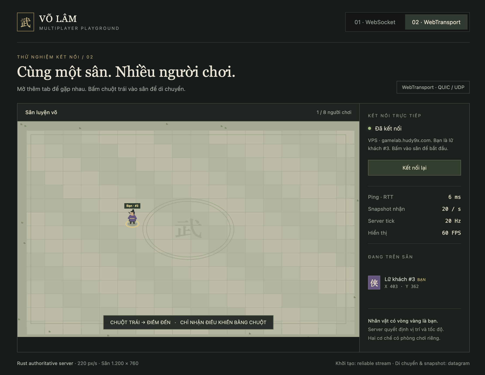

# Võ Lâm Idle — local TypeScript + Fastify + SQLite

Yêu cầu Node.js 24 trở lên. `npm ci` cài Fastify và các công cụ build/type-check.
Server dùng Fastify, source TypeScript chạy trực tiếp bằng hỗ trợ type stripping
của Node.js 24; không cần `tsx`, `ts-node` hay output JS riêng cho server.

```sh
npm ci
npm run build
npm start
# http://127.0.0.1:3000
```

`npm run dev` bật môi trường development và Node watch. `PORT=3001 npm start` đổi port.
`DB_PATH=/absolute/path/test.sqlite npm start` dùng database riêng.

## Vấn đề đã xác nhận, tạm hoãn sửa

**2026-10-19 — Điểm tiềm năng Nội công chưa tăng sát thương phép ở tất cả môn phái**,
bao gồm Côn Lôn và Võ Đang. Người dùng yêu cầu ghi nhận, tạm thời chưa bật lại.

- `src/client/combat/skills-01.js`: biến dùng chung `s7 = 0`.
- `src/client/core/attributes-02.js`, hàm `F2`: nhánh `if (!a && s7)` nhân sát
  thương chiêu nội công với `1 + (A.eng || 0) / 500`, nhưng hiện không chạy.
- Nội công vẫn tăng nội lực tối đa và hồi nội lực trong `j0`
  (`src/client/core/attributes-01.js`); sát thương phép vẫn có từ kỹ năng,
  trang bị và hỗ trợ, chỉ thiếu phần tăng theo điểm Nội công.
- Đã tái hiện với Thiên Lôi Chấn Nhạc cấp 27: Nội công 2798 → 2898, các thông số
  khác cố định, lôi sát `F2` vẫn là 368 → 368. Lực tay trên UI lấy từ kết quả này.
- Khi xử lý sau này, cần xác nhận công thức/cân bằng mong muốn trước khi bật
  `s7`: thay đổi ảnh hưởng mọi chiêu nội công, không chỉ Côn Lôn hay tooltip.
  Không tự bật cờ này khi sửa animation hoặc tầng phụ của kỹ năng.

## Cân bằng sát thương Tống Kim

Hệ số `BATTLEFIELD_PVP_DAMAGE` trong
[`src/client/simulator/balance.ts`](src/client/simulator/balance.ts) dùng để cân bằng
sát thương giữa **người chơi và SIM, hoặc SIM với SIM trong Tống Kim**.
**Giá trị hiện tại là `0.2` (20%)**, dùng chung cho game thường và `dev:arena`.
Đây là tham số cân bằng của dự án, không phải công thức VLTK/VNG gốc đã được xác minh.
Boss và binh sĩ NPC không chịu hệ số giảm PvP này.

**Công thức này cố ý triệt tiêu phần lớn sát thương gốc để đảm bảo sự cân bằng
trong chiến trường. Với `0.2`, chỉ giữ lại 20% và loại bỏ 80% sát thương ngay
trước bước tính kháng; các lớp phòng thủ sau đó còn tiếp tục giảm HP thực mất.**
Vì vậy, lực tay vài nghìn trên giao diện không đồng nghĩa mỗi hit làm mất vài
nghìn HP của đối phương. Mức cân bằng cụ thể vẫn cần được kiểm nghiệm khi chơi.

Công thức và thứ tự xử lý:

```text
k = BATTLEFIELD_PVP_DAMAGE = 0.2
Sát thương từng thành phần trước kháng = sát thương gốc thành phần đó × k

Các thành phần vật lý / băng / hỏa / lôi / độc × k
    → công thức trúng đòn, kháng, khắc hệ và chí mạng của kỹ năng
    → khiên sát thương → hấp thụ chung / theo hệ
    → chuyển hóa sát thương thành MP → nội lực hộ thân
    → HP thực mất
```

Hệ số được nhân **một lần cho mỗi hit**, trước hàm `hs`, lên từng thành phần
sát thương và phần cộng sát thương khắc hệ `series5`. Độc từ aura cũng dùng
hệ số PvP; sát thương độc duy trì được trừ theo các tick sau, không cộng ngay
toàn bộ vào HP mất của hit đầu. Chuyển hóa sát thương thành MP không trực tiếp
giảm HP mất, nhưng MP hồi có thể được nội lực hộ thân dùng để hấp thụ hit đó.
Chi tiết triển khai nằm trong [`runtime.ts`](src/client/simulator/runtime.ts),
[`state-and-save-01.js`](src/client/core/state-and-save-01.js) và
[`defense.ts`](src/client/simulator/defense.ts).

Ví dụ giản lược, chỉ xét hệ số PvP và kháng hiệu dụng 75%, bỏ qua các yếu tố khác:

```text
HP mất ≈ sát thương gốc × k × (1 − kháng / 100)
       ≈ 10.000 × 0.2 × (1 − 75 / 100)
       ≈ 500 HP
```

Giá trị cũ `0.05` chỉ giữ 5% (loại bỏ 95% trước kháng); trong ví dụ trên chỉ
còn 125 HP. Khi thử nghiệm với `1`, lớp cân bằng PvP giữ nguyên 100% sát thương
gốc, nhưng kháng và các lớp phòng thủ vẫn có hiệu lực. Khi chỉnh hệ số này,
cần đối chiếu cùng build, chiêu, mục tiêu và trạng thái phòng thủ; không kết luận
hai môi trường khác công thức chỉ từ số damage hiển thị.

## Cấu trúc thư mục

```text
src/client/       Game, UI, combat, map và bootstrap trên trình duyệt
src/server/       Fastify, API, SQLite và phục vụ tài nguyên
public/           HTML, CSS, dữ liệu legacy, ảnh, âm thanh và font
database/         Migration, seed và SQLite local
tools/            Build, database, tài nguyên và công cụ map-tool/
test/             Kiểm thử tự động
docs/             Đặc tả, hướng dẫn và manifest tài nguyên skill
output/           Ảnh chụp và kết quả kiểm tra
```

File trên ổ đĩa đã được gom theo vai trò. URL trình duyệt vẫn giữ nguyên:
`/client/bootstrap.js` trỏ đến `src/client/bootstrap.js`, `/app/...` trỏ đến
`src/client/...`, riêng ảnh `/app/maps/...` và tài nguyên như `/img/...` được đọc từ `public/`.
Server chỉ phục vụ các đường dẫn trong allowlist; không mở toàn bộ repository.
Game được build thành `src/client/game.js` và source map; hai file này không đưa vào Git.
Map editor chạy từ `tools/map-tool/` và vẫn chọn root repository làm workspace.

## Đọc và chỉnh sửa server

Bắt đầu tại [src/server/index.ts](src/server/index.ts). `createServer()` tạo app nhưng
không mở port; `startServer()` mới listen ở `127.0.0.1`. Import factory từ test
không tự khởi động server. Luồng khởi tạo:

```text
index.ts -> mở SQLite -> build game -> seed catalog -> tạo Fastify
                                                    |
                             headers / origin / parser / error handler
                                                    |
                              routes/api.ts + routes/static.ts
                                                    |
                     startServer() -> listen -> SIGINT/SIGTERM -> close
```

| File | Trách nhiệm |
| --- | --- |
| `src/server/index.ts` | Factory, cấu hình Fastify, khởi động/dừng server |
| `src/server/routes/api.ts` | Config, health, storage, catalog và báo cáo tài nguyên |
| `src/server/routes/static.ts` | Phục vụ file theo whitelist, stream tài nguyên, rebuild game khi reload |
| `src/server/database.ts` | SQLite, kiểm tra dữ liệu save, transaction, retry batch và reset |
| `src/server/assets.ts` | Kiểm tra byte ảnh/audio/font, sửa base64, tải/cache tài nguyên |
| `src/server/http.ts` | JSON response, parse body, kiểu lỗi HTTP |
| `src/server/paths.ts` | Root của dự án và kiểm tra file đang được chạy trực tiếp |
| `src/server/types.ts` | Kiểu services, cấu hình server và payload storage |
| `database/seeds/catalog.ts` | Nhập catalog từ dữ liệu game vào SQLite |

Server giữ URL/payload/status API, SQL schema, transaction và database hiện có.
Giới hạn body vẫn là **8.000.000 byte**, mỗi giá trị save tối đa **2.000.000 ký tự**.
Fastify chỉ dùng ở backend; không đưa framework vào bundle game.
Không dùng static plugin mở toàn bộ repo: chỉ các file trong whitelist được đọc
qua HTTP, vì cùng repo còn chứa SQLite, source server và `.git`.

```sh
npm run typecheck # kiểm tra combat TS + server TS bằng hai tsconfig riêng
npm run build     # type-check cả hai, sinh bundle JS của game + source map
npm run dev       # Node watch chạy src/server/index.ts trực tiếp
npm start         # chạy src/server/index.ts trực tiếp
npm test          # integration HTTP/SQLite, Fastify và các test game
```

`tsconfig.server.json` dùng NodeNext, strict và chỉ cho phép cú pháp TS có thể
xóa kiểu. `tsconfig.json` dành cho combat trên trình duyệt. `src/server/package.json`
và `database/package.json` xác định ESM cho hai nhóm này; tools/test JS hiện có
tiếp tục dùng CommonJS và import TS qua Node.js 24.
Factory trả `{ app, server, db }`: `app` là Fastify instance (dùng `inject`,
`ready`, `listen`, `close`), `server` là Node HTTP handle. Khi dùng handle trực
tiếp, gọi `await app.ready()` trước `server.listen`; sau đó `await app.close()`
và đóng `db` do caller quản lý.

## Phòng test 10 môn phái

```sh
npm run dev:arena
# http://127.0.0.1:3002
```

Phòng test tự tạo 10 nhân vật độc lập, mỗi phái một nhân vật **cấp 150**,
**500 điểm kỹ năng chưa phân bổ**. Dùng database riêng
`database/combat-arena.sqlite`, không thay đổi save game chính. Không cần đăng nhập.

- Bấm nút tên phái trong bảng **Phòng test** ở góc trên trái để đổi ngay;
  điểm đã phân bổ, trang bị và tiến độ từng nhân vật được giữ khi đổi phái/reload.
- Chiêu 90 luôn được nâng tối đa theo dữ liệu từng chiêu, kể cả nhân vật test
  đã lưu trước đây; không tiêu hao 500 điểm kỹ năng. Chiêu tổng hợp vẫn theo điều kiện kỹ năng nền
  của game. Bấm nút chiêu để chọn và tự trang bị đúng loại vũ khí; dùng GM để
  nhận thêm điểm nếu cần.
- Lọc quái theo tên/ID, **cấp** và **độ hiếm: Thường / Boss / Hoàng Kim**.
  Cấp lọc theo khoảng xuất hiện gốc trong dữ liệu bản đồ; bỏ trống để xem tất cả.
  Chọn loại và số lượng **1–20**, rồi bấm **Tạo lại quái**. Quái được tạo ở cấp
  đã lọc, hoặc cấp thấp nhất trong khoảng xuất hiện nếu không lọc cấp.
  Quái chưa có thông tin cấp trong bản đồ chỉ xuất hiện khi không lọc cấp và
  dùng cấp 150 khi tạo trong phòng test.
  Mỗi con có **100.000 HP**; mỗi đòn chạm nhân vật gây đúng **1 sát thương**.
- Có checkbox **Quái đứng yên**, nút **Xóa quái**, và có thể thu gọn bảng bằng
  cách bấm tiêu đề. Đổi phái tạo lại loại quái đã chọn và xóa hiệu ứng cũ.
- Checkbox **Hiển thị HP cạnh tên quái** hiện sinh lực hiện tại/tối đa và được
  lưu lại. Quái chết tự hồi sinh sau **3 giây** tại vị trí tạo ban đầu, đúng
  loại/cấp/độ hiếm và số lượng đã chọn. Xóa quái, tạo lại hoặc đổi phái hủy lịch cũ.
- Trong chi tiết kỹ năng có **Cộng tối đa** (dùng điểm còn lại, theo giới hạn
  cấp học) và **Xóa hết điểm** (hoàn lại điểm kỹ năng đã cộng). Chiêu 90 luôn
  tối đa trong phòng test nên các nút thay đổi điểm của chiêu 90 được khóa.
- Phòng test dùng combat, va chạm và vật cản hiện tại; không tự sinh đợt quái,
  nhận XP hay loot khi giết quái. Sinh lực tối đa nhân vật tính theo chỉ số gốc
  của game; tạo lại quái giữ nguyên sinh lực/nội lực đang có, không tự hồi đầy.

Chế độ này chỉ được bật bởi `COMBAT_SANDBOX=1` cùng môi trường development;
`npm start` và `npm run dev:combat` giữ luồng chơi thông thường.

## Tạo nhân vật local để test combat

```sh
npm run dev:combat
# http://127.0.0.1:3001
```

Lệnh này bật development (có nút **GM**) và Node watch, dùng database riêng
`database/combat-test.sqlite`. Nhân vật test được lưu qua các lần khởi động;
save chính trong `database/game.sqlite` không bị thay đổi. Không cần tài khoản
hoặc mật khẩu. Dừng server bằng `Ctrl+C`.

1. Mở địa chỉ trên, chọn ô trống → **Tạo Nhân Vật**. Có tối đa 3 ô.
2. Nhập tên, chọn giới tính **Nam** và hệ theo bảng dưới.
3. Vào game, bấm **GM** ở góc trên trái → **+100 triệu điểm kinh nghiệm**.
4. Đạt cấp 10, gia nhập môn phái tương ứng. Tiếp tục tăng cấp bằng GM,
   rồi học và chọn chiêu cần test trong thẻ **Võ công**.

| Tên gợi ý | Hệ | Môn phái | Chiêu cấp 90 cần test |
|---|---|---|---|
| Combat-WuDang | Thổ | Võ Đang | Thiên Địa Vô Cực |
| Combat-CaiBang | Hỏa | Cái Bang | Phi Long Tại Thiên / Thiên Hạ Vô Cẩu |
| Combat-ThienNhan | Hỏa | Thiên Nhẫn | Thiên Ngoại Lưu Tinh |

Lệnh chỉ khởi động môi trường test; bạn tạo nhân vật và học chiêu qua giao diện.

Các chiêu 90 trong phòng test có quy tắc riêng: Phong Sương Toái Ảnh tính
va chạm từng tia; Nhân Kiếm Hợp Nhất tính ba kiếm và một đòn phụ; Lôi Động
Cửu Thiên gây một đòn mỗi 300ms trong 3 giây cho quái còn trong vùng.
Tia sét của Lôi Động Cửu Thiên rơi trong khoảng 0,33 giây rồi chuyển sang
sprite nổ tại cùng vị trí; 16 tia rơi lệch nhau 2 frame. Nhịp hình ảnh này
độc lập với nhịp sát thương, không tăng số lần trúng.
Phi Long Tại Thiên và Thiên Hạ Vô Cẩu không gây sát thương quanh người tung
chiêu. Phạm vi nổ của Phi Long và ba chiêu 90 Đường Môn giảm còn 1/3.
Nhiếp Hồn Nguyệt Ảnh hiện hiệu ứng tại từng quái bị đạn xuyên hoặc vùng phụ
đánh trúng, tối đa một hiệu ứng mỗi quái trong một lần tung chiêu; hiệu ứng
này chỉ để hiển thị, không gây thêm sát thương.
Âm Phong Thực Cốt và Huyền Âm Trảm giảm phạm vi sát thương va chạm còn 2/3
(150 còn 100 đơn vị), giữ nguyên tầm xuất chiêu.
Vô Tướng Trảm và Đạt Ma Độ Giang giảm vùng sát thương va chạm còn 1/3;
Hoành Tảo Thiên Quân dùng vùng sát thương quanh người tung chiêu. Hai chiêu
Thiên Vương Phá Thiên Trảm và Truy Tinh Trục Nguyệt dùng sprite bay của
chiêu chính để kiểm tra va chạm, thay cho sprite phụ chỉ có hiệu ứng trúng đòn.
Hình hiển thị của Phá Thiên Trảm là `fx/m138_hit.webp`, Truy Tinh Trục Nguyệt
là `fx/m139_hit.webp`; mỗi lần tung chiêu chỉ chạy một sprite sheet màu vàng
tại điểm trúng đầu tiên, giữ nguyên tọa độ cho đến khi hết animation. Đường
bay dùng để kiểm tra va chạm được ẩn, cách tính sát thương giữ nguyên.
Thiên Ngoại Lưu Tinh giữ cố định hiệu ứng; Thiên Địa Vô Cực chạy animation
nhanh gấp đôi, không thay đổi nhịp tính sát thương.

## Demo multiplayer — WebSocket và WebTransport

Hai demo nhiều người chơi thật, server viết bằng **Rust**, client vẽ nhân vật
bằng Canvas. **Chỉ bấm chuột trái vào vị trí muốn đến**; không hỗ trợ phím mũi
tên hoặc WASD. Mỗi tab là một nhân vật, tối đa **8 người/phòng**. Server quyết
định vị trí với tốc độ 220 px/s, cập nhật và gửi snapshot ở 20 Hz; client nội suy
để hiển thị mượt. Hai cơ chế có phòng riêng, chạy độc lập với save và combat của game.

Chạy từ root repository, mỗi lệnh trong một terminal riêng (cần Rust 1.88+):

```sh
# Terminal 1: WebSocket
cargo run --manifest-path src/server/multiplayer-demo/Cargo.toml --bin demo-websocket

# Terminal 2: WebTransport
cargo run --manifest-path src/server/multiplayer-demo/Cargo.toml --bin demo-webtransport
```

| Cơ chế | Chơi hoàn toàn local | Client local kết nối server VPS |
|---|---|---|
| WebSocket | [Mở demo local](http://localhost:3101/websocket/) | [Thử WSS trên VPS](http://localhost:3101/websocket/?server=https%3A%2F%2Fgamelab.hudy9x.com%2Fmultiplayer-demo%2F) |
| WebTransport | [Mở demo local](http://localhost:3102/webtransport/) | [Thử QUIC/UDP trên VPS](http://localhost:3102/webtransport/?server=https%3A%2F%2Fgamelab.hudy9x.com%2Fmultiplayer-demo%2F) |

Mở hai tab cùng một link để thử di chuyển đồng bộ. Với chế độ VPS, giao diện
vẫn được phục vụ local, còn dữ liệu di chuyển gửi tới VPS; khung kết nối hiện
**VPS · gamelab.hudy9x.com**. WebSocket dùng WSS qua nginx/Cloudflare;
WebTransport dùng QUIC/UDP trực tiếp tới `103.121.91.177:4433`, với fingerprint
chứng chỉ lấy qua HTTPS. Giao diện có ping RTT, số snapshot nhận mỗi giây và FPS.

Client nằm trong `src/client/multiplayer-demo/{websocket,webtransport}/`, server
nằm trong `src/server/multiplayer-demo/{websocket,webtransport}/`.
Xem [hướng dẫn demo và kiểm thử](src/server/multiplayer-demo/README.md) hoặc
[triển khai, vận hành trên VPS](deploy/multiplayer-demo/README.md).



## Multiplayer trong game — WebTransport + Rust

Demo tham khảo đã được lưu ở commit `6d6a72f`. Bản tích hợp dùng thư mục riêng:
`src/client/multiplayer/webtransport/` và `src/server/multiplayer/webtransport/`.
Hai account cùng map có thể thấy nhân vật và chuyển động của nhau; điều khiển
di chuyển bằng chuột trái. Dữ liệu QUIC dùng binary little endian: gói vị trí
20 byte, snapshot đủ 32 người 592 byte, roster ngoại hình đi qua stream tin cậy.

Đợt này đồng bộ presence và di chuyển, chưa đưa va chạm/chống gian lận hay chiến đấu
lên Rust. Xem [phạm vi, giao thức và cách chạy local](src/client/multiplayer/webtransport/README.md)
và [cấu hình VPS riêng cho bản tích hợp](deploy/multiplayer/README.md).

## Kiến trúc

Nút **Xóa log** xóa toàn bộ log của nhân vật hiện tại; **Copy log** sao chép
các sự kiện phù hợp bộ lọc (tối đa 300 dòng), không kèm tên chiêu thức. Bộ lọc
và các nút vẫn thao tác được khi sát thương liên tục cập nhật.

Tab **Log** cạnh Thế giới/Hệ thống ở góc dưới trái ghi sát thương thực tế của
nhân vật đang chơi: gây lên quái, nhận từ quái, độc/hiệu ứng duy trì và phản đòn.
Chọn **Cả hai / Gây sát thương / Nhận sát thương** để lọc; lựa chọn được lưu
theo nhân vật. Log ghi HP thực tế bị mất và đòn trượt/né theo chiều gây hoặc
nhận; không ghi hồi máu hoặc mô phỏng offline. Khi vượt HP còn lại, số ghi là HP thực tế đã mất.
Giữ tối đa 300 sự kiện trong phiên, hiển thị 100 dòng mới nhất phù hợp bộ lọc;
đổi nhân vật hoặc reload bắt đầu log mới. Thu gọn bảng Phòng test nếu nó che log.
Dòng log có dạng `<số thứ tự> - hh:ss`, với `hh` là giờ và `ss` là giây,
cùng ⚔️ thay cho chữ sát thương. Số thứ tự có tối thiểu 3 chữ số
(`001`, `002`, … `999`, `1000`). Số thứ tự giữ nguyên khi lọc, bắt đầu lại từ
1 khi xóa log hoặc đổi nhân vật.

```text
src/client/*/*.js -> tools/build-app.js -> src/client/game.js
                                     ^
public/index.html -> src/client/bootstrap.js ---+ (sau data.js + setvi.js)
                                     |
                           combat + UI + Canvas -> jxlook.js / assets
```

Đây là game web idle lấy cảm hứng từ JX1/VLTK. Combat, AI, loot, inventory,
forge và nhiệm vụ chạy ở trình duyệt từ source trong `src/client/`. Repo ban đầu có các file JS/CSS
rỗng; chúng được khôi phục từ https://volamidle.pages.dev/ (bản v622, ngày 11/10/2026).

## Chỉnh sửa game

Source trong `src/client/` được tổ chức theo nhóm
data, core, combat, gameplay, render, UI, systems, online và dev.
Xem [src/client/README.md](src/client/README.md) để tìm đúng nhóm.
`src/client/modules.json` giữ thứ tự ghép và danh sách symbol từng file.

```sh
npm run typecheck # kiểm tra kiểu TS, không sinh file
npm run build   # kiểm tra kiểu, build cả JS + TS thành src/client/game.js + source map
npm test       # kiểm tra module/source map, GM và luồng SQLite/HTTP
npm start      # tự build lúc khởi động và mỗi lần browser tải /app/game.js
```

Chỉnh file source rồi reload trình duyệt. DevTools dùng source map để hiển thị
file trong `src/client/`. Không sửa `src/client/game.js`: đây là output được tạo lại tự động.
Các module JS cũ vẫn dùng chung scope và tên biến từ bản gốc; builder ghép chúng
trong cùng IIFE để giữ hành vi. Phần va chạm combat đã dùng các ES module TypeScript.

### Đọc combat từ `index.ts`

Bắt đầu tại [src/client/combat/index.ts](src/client/combat/index.ts). File này mô tả luồng và
export API dễ đọc: `castSkill`, `updateCombat`, `drawFallbackProjectile`.

```text
JS chọn skill / mana / cooldown (oD, eD)
    |
    v
index.ts -> castSkill -> casting.ts (tạo cast + gắn đạn/vùng)
    |
Game loop Td -> updateCombat(dt) -> simulation.ts
                                    |
                                    v
                              collision.ts -> geometry.ts
                                    |
                                    v
                               damage.ts (chống hit trùng / chia pulse)
                                    |
                                    v
                         onHit JS cũ -> damage / HP / debuff / log

Canvas -> drawFallbackProjectile -> render.ts (chỉ vẽ)
```

| File | Đọc/chỉnh gì |
| --- | --- |
| `src/client/combat/index.ts` | Điểm bắt đầu, API và thứ tự xử lý |
| `src/client/combat/types.ts` | Kiểu skill, mục tiêu, cast, đạn/vùng chiêu và callback |
| `src/client/combat/config.ts` | Phạm vi xuất chiêu elip và skill bỏ qua vật cản |
| `src/client/combat/casting.ts` | Vùng chữ nhật hẹp, hệ số thu nhỏ vùng nổ, số hit, windup, nhịp và thời hạn |
| `src/client/combat/simulation.ts` | Cập nhật chuyển động, thời gian tồn tại, cleanup và hàng đợi FX |
| `src/client/combat/geometry.ts` | Quét đường đạn qua hình tròn/chữ nhật |
| `src/client/combat/collision.ts` | Lọc/sắp xếp va chạm, vùng nổ và các quái chồng nhau |
| `src/client/combat/damage.ts` | Giới hạn số hit và một lượt damage mỗi pulse trước khi gọi `onHit` |
| `src/client/combat/impact-fields.ts` | Hoa sen Băng Tung Vô Ảnh theo từng tia va chạm, vùng sát thương 80 |
| `src/client/combat/damage-labels.ts` | Gộp damage trong 120 ms, xếp tối đa 4 dòng theo từng mục tiêu và bảng màu |
| `src/client/combat/render.ts` | Vẽ đạn/vùng thay thế khi thiếu sprite |
| `src/client/combat/legacy-bridge.js` | Nối tên hàm JS hiện có sang API TS, dùng chung state |
| `src/client/combat/legacy-globals.d.ts` | Khai báo kiểu tại biên TS/JS, không tạo state mới |

Số damage bám theo thân mục tiêu, xếp dọc tối đa 4 dòng (3 khi giảm FX).
Số mới xuất hiện giữa thân rồi bay lên ngay với tốc độ `riseSpeed` (mặc định 40 px/s).
Số cũ tiếp tục bay lên, vẽ phía sau số mới; không dạt ngang. Khoảng hở tối thiểu
giữa hai dòng là 2 px, tính từ kích thước chữ thực tế và viền, kể cả khi chí mạng to hơn.
Hit cùng mục tiêu, loại sát thương, chí mạng và ký hiệu ngũ hành trong 120 ms
được cộng từ số gốc rồi mới làm tròn, ví dụ chỉ hiện `325` trên mục tiêu.
Thời gian tồn tại lấy từ `lifetime` / `lowFxLifetime`, tính từ lần cập nhật cuối.
HP và dữ liệu log gốc vẫn xử lý riêng từng hit;
log hiển thị/copy gộp các hit cùng mục tiêu, chiều và chiêu trong 120 ms, có `×N`.
Số thứ tự của dòng log gộp là số thứ tự hit đầu tiên trong nhóm.
Đổi phái/tạo lại quái trong arena sẽ xóa số cũ.
Chỉnh `DAMAGE_LABEL_LAYOUT` và `DAMAGE_LABEL_COLORS` trong `damage-labels.ts`:

| Loại | Màu |
| --- | --- |
| Mọi hệ sát thương / mặc định | Đỏ `#ff6262` |
| Chí mạng / trọng kích (ưu tiên hơn màu hệ) | Vàng `#ffe170` |
| Trượt / né / hóa giải | Xám `#d5d9df` |

Lần chuyển này giữ nguyên công thức va chạm, phạm vi, tốc độ, nhịp damage và thứ
tự tick. Các công thức chỉ số/sát thương trong `core/`, dữ liệu skill và render
sprite trong JS tiếp tục chạy qua callback/bridge hiện tại; **chưa chuyển toàn bộ
game sang TS**. Không đổi tên các API mà JS đang gọi để tránh ảnh hưởng code cũ.
Trong TS, import từ `index.ts` khi cần API công khai; các file nội bộ import trực
tiếp từ module phụ thuộc để dễ lần theo luồng.

### Build khi JS và TS cùng tồn tại

```text
tsc --noEmit (strict) -> kiểm tra kiểu TS
JS trong modules.json ------------------+
TS index.ts -> esbuild + các import -----+-> IIFE game.js + game.js.map
```

TypeScript, esbuild và sourcemap-codec là công cụ build; trình duyệt chỉ tải JS.
Không cần sinh thêm một bộ `.js` cạnh source `.ts`. Thêm một TS entry vào
`modules.json` cùng tên `global`; những file mà entry import được bundler tự tìm.
Giữ entry ở đúng vị trí khởi tạo của module JS được thay thế. Sửa cả file TS
được import rồi reload đều sẽ build lại; source map trỏ về dòng/cột TS gốc.
Server tự build để tiện dev; chạy `npm run build` trước khi phát hành để kiểm tra
kiểu, vì lần build tự động khi reload chỉ biên dịch nhanh.

`npm test` chạy tuần tự vì các test HTTP cùng dùng output `src/client/game.js`. Các test
combat dùng đúng entry TS đã bundle, kiểm tra cả hành vi cũ và bridge. Test build
kiểm tra source map và việc cập nhật file TS được import.

## Va chạm và thời điểm gây sát thương

Click quái ưu tiên chọn mục tiêu trước đồ rơi, đổi sang điều khiển manual và
nhấp nháy vòng vàng dưới chân trong 1 giây. Rê chuột lên vùng chọn quái
hiện con trỏ dao nền trong suốt (`img/ui/attack-dagger.svg`), điểm click ở đầu
dao; vùng chọn bao phủ thân và đầu, riêng với hitbox sát thương.
Nếu ngoài tầm, nhân vật tiến vào tầm để ra đòn đầu tiên. Sau khi xuất chiêu,
nhân vật giữ vị trí và tiếp tục đánh nếu mục tiêu còn trong tầm; không tự đuổi
khi mục tiêu chạy ra xa. Click một mục tiêu hoặc vị trí mới để ra lệnh tiếp.
Thời gian giữa các đòn vẫn được giữ, nhưng bộ đếm tiếp tục giảm khi đứng chờ
trong manual để không phát sinh độ trễ do bộ đếm bị đóng băng.

`src/client/combat/index.ts` dẫn đến các module cập nhật đạn và vùng đánh trong vòng mô phỏng.
Đạn phải cắt hitbox mục tiêu; đạn và cận chiến có 0,12 giây ra đòn. Đạn thẳng giữ
hướng ban đầu; đạn truy đuổi bẻ hướng theo dữ liệu chuyển động của từng chiêu.
Vùng skill đứng yên xuất hiện tại tọa độ khởi tạo, không chạy theo người tung
chiêu hoặc mục tiêu. Mục tiêu di chuyển ra khỏi đường đạn/vùng đánh có thể né.
Thiên Ngoại Lưu Tinh, Thiên Địa Vô Cực, Phong Sương Toái Ảnh và Lôi Động Cửu Thiên bỏ qua vật cản
khi xuất chiêu và xử lý hiệu ứng (kể cả hiệu ứng phụ). Vẫn phải đủ tầm đánh
và chạm hitbox/nằm trong vùng ảnh hưởng đang hoạt động mới nhận sát thương.
Vân Long Kích và Nhân Kiếm Hợp Nhất dùng vùng chữ nhật hẹp theo hướng chiêu,
không tạo sát thương tròn quanh mục tiêu. Mọi quái có hitbox giao vùng đều bị
đánh, kể cả nhiều quái chồng cùng tọa độ; đạn không xuyên vẫn dừng tại điểm
va chạm đầu tiên và chỉ đánh các hitbox cùng giao điểm đó.
Thiên Ngoại Lưu Tinh và Nghiệp Hỏa gây sát thương theo nhịp **300 ms** trong
thời gian hiệu ứng còn tồn tại. Vùng giữ tọa độ ban đầu, kiểm tra quái đang ở
trong vùng tại mỗi nhịp; nhiều lớp hình ảnh không nhân đôi sát thương cùng nhịp.
Va chạm quét cả đoạn chuyển động của đạn
để tránh bỏ sót mục tiêu khi đạn chạy nhanh.

Băng Tung Vô Ảnh tạo **một hoa sen cho mỗi cặp tia/quái va chạm**: ba tia chạm
ba quái tạo ba hoa sen, nhiều tia chạm cùng một quái tạo nhiều lần nở hoa tại cùng
tọa độ. Một tia không tạo lại hoa sen trên cùng quái ở mỗi tick. Hoa sen dùng
`fx/m188_fly.webp`, giữ tọa độ lúc va chạm và tồn tại theo animation. Mỗi hoa sen
có vùng sát thương bán kính **80 đơn vị game**; mỗi quái trong vùng nhận một
lượt sát thương phụ từ mỗi hoa sen, kể cả quái đi vào khi hoa sen còn hoạt động.
Các hoa sen chồng nhau có vùng/damage độc lập. Công thức sát thương lạnh của
Băng Tâm Tuyết Liên được giữ; tắt/giảm FX vẫn mô phỏng vùng đúng.

Hiệu ứng hình ảnh dùng cùng vị trí mô phỏng; giới hạn số FX, tùy chọn giảm hiệu
ứng và mô phỏng offline không quyết định damage. Chiêu phụ gây damage và debuff
cũng chờ va chạm. Độc đã trúng tiếp tục tick; aura và bẫy kiểm tra vùng tác động.
Hitbox dùng hình học của cơ thể và vùng skill, không kiểm tra từng pixel sprite.

Test combat dùng dữ liệu Thiếu Lâm, Võ Đang, Cái Bang và Thiên Nhẫn để kiểm tra
Vô Tướng Trảm, Thiên Địa Vô Cực, Phi Long Tại Thiên, Thiên Hạ Vô Cẩu và vùng nổ
Thiên Ngoại Lưu Tinh: thời điểm damage, né đạn, truy đuổi, tâm cố định, phạm vi,
thời hạn hiệu lực, xuyên mục tiêu, địa hình và tính độc lập với việc vẽ hình.

```text
Game -> localStorage + outbox -> POST /api/storage -> Node HTTP -> SQLite
Reload <- hydrate localStorage <- GET /api/storage <------------+
```

SQLite ở `database/game.sqlite`, chế độ WAL. File `-wal` và `-shm` là file phụ
của SQLite; khi sao lưu lúc server đang chạy, dùng công cụ SQLite backup hoặc dừng
server trước khi copy. Save giữ nguyên chuỗi JSON và checksum của game.

- `storage`: save 3 slot (`jxidle`, `jxidle_2`, `jxidle_3`), backup, kho chung và settings.
- `characters`: SQL view để xem tên/cấp/môn phái từ save, không sửa save gốc.
- `game_data`: 19 nhóm dữ liệu cấu hình từ data.js và bản dịch setvi.js; một số entry
  là nhóm lồng nhau. Đây là bản sao để truy vấn/test; runtime vẫn dùng data.js gốc.
- `metadata`: phiên database, trạng thái nhập save và hash catalog.
- `applied_batches`: chống áp dụng lại request khi reload/retry.

Bootstrap đọc SQLite trước khi chạy game. Lần đầu database chưa khởi tạo, nó nhập
các key game sẵn có trong localStorage của chính origin hiện tại. Save ở website
khác không tự chuyển sang local; có thể dùng tính năng xuất/nhập .jxsave của game.
Writes đồng bộ bất đồng bộ theo thứ tự; outbox trong trình duyệt giữ các request
chưa hoàn tất để thử lại sau reload hoặc mất kết nối. Save chưa gửi xong khi đóng
trình duyệt sẽ được gửi tiếp khi mở lại cùng origin. Giữ nguyên host/port khi test.

Đây là **một profile test local dùng chung database**, không có tài khoản riêng.
Supabase production bị tắt qua CHAT_CFG; chat online, tổ đội online, tài khoản,
giftcode và các hoạt động cần backend online chưa được triển khai trên SQLite.
Server bind `127.0.0.1`, dùng cho local test.

## Tài nguyên

```text
GET asset -> file đã có? -> trả file
                 |
                chưa -> tải từ website gốc -> lưu img/fx/snd/fonts/ui -> trả file
```

Các sprite/audio chưa có cần Internet khi truy cập lần đầu. File đã tải dùng lại
trên máy. Đây chưa phải bộ tài nguyên offline đầy đủ. JS/CSS/API không được service
worker cache để tránh đọc code hoặc save cũ. Khi chạy production, ảnh (bao gồm ảnh
map), audio và font có HTTP cache một ngày; service worker dùng cache-first một
ngày, giữ tối đa 512 URL và dùng bản đã cache nếu mạng mất khi hết hạn. Query string
thuộc cache key, nên có thể thêm `?v=...` để cập nhật một ảnh ngay; tăng version trong
`public/sw.js` để xóa toàn bộ cache media PWA. Không precache hàng loạt tài nguyên.
Ảnh map nằm tại `public/app/maps/content/<id>/` (và `public/app/maps/objects/`
nếu có), còn map/project JSON ở `src/client/maps/content/<id>/`. Giữ URL
`/app/maps/...` và tham chiếu `./assets/...` trong JSON; chuyển thư mục không làm
mất cache đã tải. `node tools/maps/migrate-assets.ts` chuyển ảnh từ cấu trúc cũ,
kiểm tra trùng byte trước khi di chuyển và có thể chạy lại an toàn.
Nginx production có thể phục vụ trực tiếp ảnh map theo cấu hình trong
`deploy/vltk-web.nginx.conf`; cần áp dụng cấu hình và reload nginx riêng khi nâng cấp.

Màn hình khởi động tải trước ảnh UI chung, sprite/hiệu ứng của nhân vật và ảnh của
map hiện tại. Màn hình chọn nhân vật chỉ tải portrait và UI; các map khác giữ tải
theo nhu cầu. Progress đếm số ảnh đã tải và decode thành công, tối đa 4 job đồng
thời; ảnh lỗi/timeout chưa được tính hoàn tất và có nút thử lại riêng phần lỗi.
Mô phỏng và xử lý input game tạm dừng trong lúc chờ asset. Tạo nhân vật mới cũng
chạy cùng preload trước khi mở phiên chơi. Các request ảnh dùng chung cache
renderer và cơ chế HTTP/PWA hiện có; không thêm cache cho API/save hay script.

Bootstrap đăng ký worker trước khi game tải sprite. Trạng thái khởi động phân biệt
kết nối máy chủ, kiểm tra đăng nhập, tải nhân vật và tải script. API GET và POST `/api/storage` thử lại một
lần khi mất mạng/timeout hoặc HTTP 502/503/504. Batch lưu giữ nguyên ID và server
loại trùng nên gửi lại an toàn; các POST khác không tự thử lại. Lỗi hiển thị
endpoint cụ thể để phân biệt lỗi cấu hình, phiên đăng nhập và dữ liệu lưu.
`NODE_ENV=development` tắt cả HTTP cache lẫn cache media PWA và xóa cache PWA cũ.

## Database và kiểm tra

```sh
npm run db:seed     # nhập/cập nhật catalog; không xóa save
npm run db:inspect  # xem nhân vật, các key save và số entry theo nhóm
npm run db:reset    # XÓA save/kho/settings của profile test, giữ catalog; reload game
npm test
```

Reset đổi generation để browser/outbox cũ không khôi phục dữ liệu đã xóa. Sau reset,
tải lại mọi tab game. Database tự khởi tạo/migrate/seed khi chạy server.

```sql
SELECT * FROM characters;
SELECT key, length(value), updated_at FROM storage;
SELECT section, count(*) FROM game_data GROUP BY section;
SELECT data FROM game_data WHERE section = 'factions' AND entry_key = '0';
```

API: `GET /api/health`, `GET /api/storage`, `POST /api/storage/init`,
`POST /api/storage`, `GET /api/catalog`, `GET /api/catalog/entry?section=maps&key=0`.
Server chỉ phục vụ các file frontend/tài nguyên được phép; không phục vụ database,
source server hoặc thư mục .git. Test dùng database tạm, không đụng save test đang chơi.

## Sửa và kiểm tra asset

```sh
npm run assets:repair      # sửa base64 và tải lại file rỗng/hỏng đã có
npm run assets:download    # tải trước asset tham chiếu trực tiếp trong JS/CSS
# Tùy chọn tải toàn bộ 9.613 sprite JXLOOK, dung lượng lớn:
node tools/download-assets.js --all-sprites
```

Công cụ Node quét source game, data, CSS và manifest, lưu trực tiếp vào repo root
để server phục vụ đúng đường dẫn. Nó kiểm tra chữ ký
PNG/WebP/JPEG/font/audio, giải mã base64 nếu cần, tải lại file hỏng và ghi atomically.

Báo cáo lần quét: `database/asset-report.json`. Báo cáo các request asset thực tế
kể từ lúc server khởi động: `GET /api/assets` (gồm repaired/downloaded/failures).
Asset sinh đường dẫn động, như sprite nhân vật JXLOOK, vẫn được tải theo nhu cầu
và kiểm tra byte trước khi trả về. Server phục vụ cả thư mục music/.

Nút Chợ hiện trong bản local; bấm nút sẽ giải thích backend giao dịch online
chưa được triển khai. Không kết nối tới Supabase production để mở Chợ.

## GameMaster (GM)

Chạy `npm run dev`, vào nhân vật rồi bấm **GM** ở góc trên trái. `npm start`
không hiển thị nút GM (trừ khi bạn chủ động đặt `NODE_ENV=development`).
Môi trường được bootstrap đọc từ `GET /api/config`, không bật bằng query trên URL.

- Vàng: +100 triệu vạn lượng = **1.000.000.000.000 lượng**.
- Cấp 150: tăng trực tiếp lên cấp 150, nhận điểm tiềm năng/kỹ năng tương ứng
  số cấp tăng và đặt XP về 0. Không hạ cấp nhân vật đã đạt cấp 150 trở lên.
- Học chiêu 90: tự tìm tất cả chiêu cấp 90 theo môn phái hiện tại, mở quyền bí kíp
  và học cấp 1 (giữ cấp chiêu đã luyện). Không tốn bí kíp hay điểm kỹ năng;
  vẫn cần đủ cấp học và đã gia nhập môn phái.
- Nâng tối đa chiêu 90: nâng các chiêu cấp 90 đã học của phái hiện tại lên
  giới hạn trong dữ liệu từng chiêu, đồng bộ tiến độ luyện và đặt XP chiêu về 0.
- Tiềm năng: thêm **3.000 điểm chưa phân bổ** vào thẻ Nhân vật mỗi lần bấm.
- Checkbox **Hiển thị phạm vi chiêu thức**: vẽ một vòng quanh nhân vật theo
  tầm đánh của chiêu chính hiện tại; đổi chiêu thì vòng cập nhật theo. Vòng tròn
  trong tọa độ game hiện thành ellipse theo góc nhìn bản đồ, dùng cùng cách tính
  khoảng cách với tầm xuất chiêu. Bán kính Bắc–Nam bằng 60% Đông–Tây (trước đây
  là 50%); Đông–Tây giữ nguyên. Chiêu đánh quanh người dùng bán kính vùng ảnh hưởng.
  Mặc định tắt mỗi lần reload; đóng bảng GM vẫn giữ vòng khi checkbox đang bật.
- Kim Nguyên Bảo: +10 vạn = **100.000 KNB**.
- Kinh nghiệm: +**100.000.000 XP**, qua logic lên cấp hiện có, không nhân bonus XP.
  Nếu đã đạt giới hạn cấp, nút báo lỗi và không thêm XP.
- Rương: +**100 rương Hoàng Kim môn phái** xếp chồng trong hành trang. Dùng từng
  rương để nhận 1 món Hoàng Kim đúng phái lúc nhận; trang bị được tự khóa. Khi
  hành trang đầy, không thêm hoặc tiêu hao rương. Rương còn mở được khi chạy lại
  bằng `npm start`.
- Nhẫn: +**2 Càn Khôn Giới Chỉ** bản gốc (Hoàng Kim, cấp đồ 10, hệ Kim, yêu cầu
  cấp nhân vật 60, tất cả kỹ năng +2). Hai chiếc có UID riêng, được khóa sẵn và lưu
  vào Hành trang; cần 2 ô trống. Không tự trang bị.

Các lệnh dùng luồng save hiện tại và được đồng bộ sang SQLite. Source GM nằm ở
`src/client/dev/game-master-01.js`.

Nút **Bán nhanh** cạnh GM cũng chỉ hiện trong development. Bấm để bật, sau đó bấm
từng món trong Hành trang để bán ngay toàn bộ món/chồng, không hỏi xác nhận.
Giá bán theo game hiện tại; món đang khóa được tự mở khóa rồi bán. Nhấn **Esc** hoặc bấm lại
nút Bán nhanh để kết thúc. Chế độ không tự bật lại sau reload.
